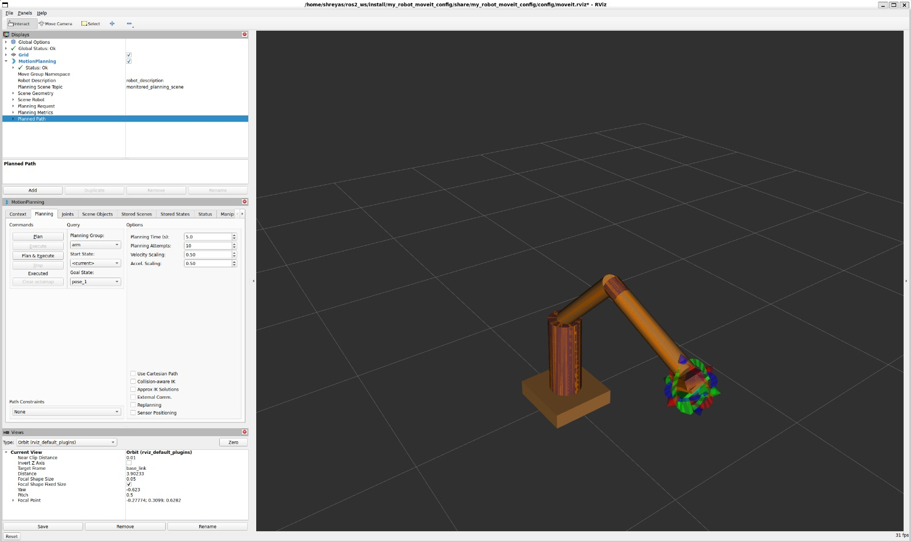
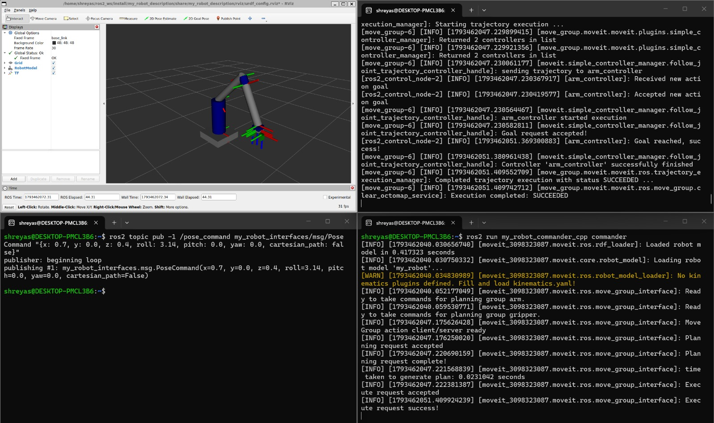

# 6-DOF Arm with Gripper (ROS 2 Jazzy + MoveIt 2)

A simulated 6-axis arm with a parallel gripper, set up for motion planning with
MoveIt 2 and controlled through a C++ commander node. It runs on mock hardware
(ros2_control `mock_components/GenericSystem`), so no real robot is needed.

## Demo




Demo videos (Google Drive folder, two clips):
- MoveIt in RViz: poses set by hand in the MotionPlanning panel, then Plan & Execute
- Commander API: pose and gripper commands sent with `ros2 topic pub`

[Watch the demo videos](https://drive.google.com/drive/folders/1jh_nVYlnCgurntZmtTK8vnjJQu4upVwr?usp=sharing)

## Requirements
- Ubuntu 24.04 (tested on WSL2)
- ROS 2 Jazzy and MoveIt 2: `sudo apt install ros-jazzy-moveit`
- ros2_control 4.48.1 or newer (older versions crashed in JointTrajectoryController)

## Build
```bash
git clone https://github.com/shreyas02005-sudo/6dof_arm_moveit.git
cd 6dof_arm_moveit
rosdep install --from-paths . --ignore-src -r -y
colcon build --symlink-install
source install/setup.bash
```

## Run

### 1. MoveIt in RViz (manual planning)
```bash
ros2 launch my_robot_moveit_config demo.launch.py
```
In RViz, set a goal pose in the MotionPlanning panel and click Plan & Execute.

### 2. RViz + commander API
Run each in its own terminal, and source the workspace in each one.

Terminal 1:
```bash
ros2 launch my_robot_bringup my_robot.launch.xml
```

Terminal 2:
```bash
ros2 run my_robot_commander_cpp commander
```

Terminal 3 (send commands):
```bash
# Move to a pose (planned move)
ros2 topic pub -1 /pose_command my_robot_interfaces/msg/PoseCommand "{x: 0.7, y: 0.0, z: 0.4, roll: 3.14, pitch: 0.0, yaw: 0.0, cartesian_path: false}"

# Move down in a straight line
ros2 topic pub -1 /pose_command my_robot_interfaces/msg/PoseCommand "{x: 0.7, y: 0.0, z: 0.2, roll: 3.14, pitch: 0.0, yaw: 0.0, cartesian_path: true}"

# Close the gripper
ros2 topic pub --once /open_gripper example_interfaces/msg/Bool "{data: false}"

# Move sideways in a straight line
ros2 topic pub -1 /pose_command my_robot_interfaces/msg/PoseCommand "{x: 0.7, y: 0.3, z: 0.2, roll: 3.14, pitch: 0.0, yaw: 0.0, cartesian_path: true}"

# Open the gripper
ros2 topic pub --once /open_gripper example_interfaces/msg/Bool "{data: true}"
```

Run only one launch at a time.

## Packages
| Package | Contents |
|---|---|
| my_robot_description | URDF/xacro, display launch, RViz config |
| my_robot_moveit_config | Setup Assistant output (SRDF, kinematics, joint limits, controllers) |
| my_robot_bringup | Launch file, controller config, RViz config |
| my_robot_interfaces | `PoseCommand.msg` |
| my_robot_commander_cpp | C++ commander node |

## Robot
- Joints: joint1 to joint6, plus a prismatic gripper (`gripper_left_finger_joint`, 0 to 0.06 m) with the right finger as a mimic joint
- Planning groups: `arm`, `gripper`
- Named states: `home`, `pose_1`, `pose_2`, `gripper_open`, `gripper_half_closed`, `gripper_closed`

## Commander topics
| Topic | Type | Use |
|---|---|---|
| /open_gripper | example_interfaces/msg/Bool | true = open, false = close |
| /joint_command | std_msgs/msg/Float64MultiArray | 6 joint values |
| /pose_command | my_robot_interfaces/msg/PoseCommand | end-effector pose; `cartesian_path: true` moves in a straight line |

## Notes
- Simulation only (mock hardware).
- RViz can look choppy on WSL2 because of software rendering (`LIBGL_ALWAYS_SOFTWARE=1`).
- Duplicate robot_state_publisher or ros2_control_node instances make the arm flicker, so run one launch at a time.
- Relaunch after any URDF or YAML change.

## License
Apache-2.0
