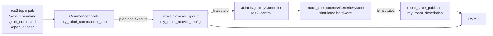

# 6-DOF Robot Arm with Gripper (ROS 2 Jazzy + MoveIt 2)


A simulated 6-axis robot arm with a parallel gripper. It uses MoveIt 2 for motion planning and ros2_control for execution, and it's driven by a C++ commander node that accepts simple ROS 2 topic commands. It runs on mock hardware, so you don't need a real robot to try it.

**[Watch the demo videos](https://drive.google.com/drive/folders/1jh_nVYlnCgurntZmtTK8vnjJQu4upVwr?usp=sharing)**

---

## Contents

- [Demo](#demo)
- [What it does](#what-it-does)
- [How it fits together](#how-it-fits-together)
- [Requirements](#requirements)
- [Build](#build)
- [Run](#run)
- [Packages](#packages)
- [The robot](#the-robot)
- [Commander interface](#commander-interface)
- [Repository layout](#repository-layout)
- [Troubleshooting](#troubleshooting)
- [What this project shows](#what-this-project-shows)
- [Limitations and next steps](#limitations-and-next-steps)
- [License](#license)

---

## Demo

| MoveIt in RViz | Commander API |
|:--:|:--:|
| [](docs/rviz-1.jpg) | [](docs/rviz-2.jpg) |

There are two clips in the [demo folder](https://drive.google.com/drive/folders/1jh_nVYlnCgurntZmtTK8vnjJQu4upVwr?usp=sharing):

- **MoveIt in RViz:** I set poses by hand in the MotionPlanning panel, then click Plan & Execute.
- **Commander API:** pose and gripper commands are sent with `ros2 topic pub`.

## What it does

- Plans and executes arm motions with **MoveIt 2**, both from RViz and from code
- Accepts **end-effector pose commands**, either as a freely planned move or as a **straight-line Cartesian path**
- Accepts **joint-space commands** for all six joints
- Opens and closes a **parallel gripper** with a single Bool message
- Runs the full pipeline (planning, trajectory controller, joint states) on **mock hardware**, so it works on any machine with ROS 2 Jazzy

## How it fits together



There are two ways to use it:

| Mode | Launch | Use it for |
|------|--------|------------|
| MoveIt demo | `my_robot_moveit_config demo.launch.py` | Planning by hand in the RViz MotionPlanning panel |
| Bringup + commander | `my_robot_bringup my_robot.launch.xml`, plus the `commander` node | Controlling the arm from code or the command line |

More detail is in [`docs/architecture.md`](docs/architecture.md).

## Requirements

- Ubuntu 24.04 (tested on WSL2)
- ROS 2 Jazzy and MoveIt 2: `sudo apt install ros-jazzy-moveit`
- ros2_control **4.48.1 or newer** (older versions crashed in `JointTrajectoryController`)

## Build

```bash
source /opt/ros/jazzy/setup.bash
git clone https://github.com/shreyas02005-sudo/6dof_arm_moveit.git
cd 6dof_arm_moveit
rosdep install --from-paths . --ignore-src -r -y
colcon build --symlink-install
source install/setup.bash
```

## Run

> Run only one launch at a time. Source the workspace (`source install/setup.bash`) in every terminal.

### 1. MoveIt in RViz (manual planning)

```bash
ros2 launch my_robot_moveit_config demo.launch.py
```

In RViz, set a goal pose in the MotionPlanning panel and click **Plan & Execute**. The named states (`home`, `pose_1`, `pose_2`) can be picked from the goal state list.

### 2. RViz and the commander API

Terminal 1, start the robot, MoveIt and RViz:

```bash
ros2 launch my_robot_bringup my_robot.launch.xml
```

Terminal 2, start the commander node:

```bash
ros2 run my_robot_commander_cpp commander
```

Terminal 3, send commands. This sequence approaches a point, descends in a straight line, grasps, moves sideways and releases:

```bash
# Move to a pose (planned move)
ros2 topic pub -1 /pose_command my_robot_interfaces/msg/PoseCommand "{x: 0.7, y: 0.0, z: 0.4, roll: 3.14, pitch: 0.0, yaw: 0.0, cartesian_path: false}"

# Move down in a straight line
ros2 topic pub -1 /pose_command my_robot_interfaces/msg/PoseCommand "{x: 0.7, y: 0.0, z: 0.2, roll: 3.14, pitch: 0.0, yaw: 0.0, cartesian_path: true}"

# Close the gripper
ros2 topic pub --once /open_gripper example_interfaces/msg/Bool "{data: false}"

# Move sideways in a straight line
ros2 topic pub -1 /pose_command my_robot_interfaces/msg/PoseCommand "{x: 0.7, y: 0.3, z: 0.2, roll: 3.14, pitch: 0.0, yaw: 0.0, cartesian_path: true}"

# Open the gripper
ros2 topic pub --once /open_gripper example_interfaces/msg/Bool "{data: true}"
```

## Packages

| Package | Contents |
|---------|----------|
| `my_robot_description` | URDF/xacro, display launch, RViz config |
| `my_robot_moveit_config` | MoveIt Setup Assistant output: SRDF, kinematics, joint limits, controllers |
| `my_robot_bringup` | Launch file, controller config, RViz config |
| `my_robot_interfaces` | `PoseCommand.msg` |
| `my_robot_commander_cpp` | C++ commander node |

## The robot

- **Joints:** `joint1` to `joint6`, plus a prismatic gripper (`gripper_left_finger_joint`, 0 to 0.06 m). The right finger is a mimic joint, so one command moves both fingers.
- **Planning groups:** `arm`, `gripper`
- **Named states:** `home`, `pose_1`, `pose_2`, `gripper_open`, `gripper_half_closed`, `gripper_closed`

## Commander interface

| Topic | Type | Use |
|-------|------|-----|
| `/pose_command` | `my_robot_interfaces/msg/PoseCommand` | End-effector pose. `cartesian_path: true` moves in a straight line |
| `/joint_command` | `std_msgs/msg/Float64MultiArray` | Six joint values |
| `/open_gripper` | `example_interfaces/msg/Bool` | `true` = open, `false` = close |

Full details and examples are in [`docs/commander-api.md`](docs/commander-api.md).

## Repository layout

```
.
├── README.md
├── LICENSE
├── .gitignore
├── docs/
│   ├── architecture.md      Packages, data flow and launch modes
│   ├── commander-api.md     Topics, message fields and example commands
│   ├── troubleshooting.md   Known problems and fixes
│   ├── rviz-1.jpg
│   └── rviz-2.jpg
└── src/
    ├── my_robot_description/
    ├── my_robot_moveit_config/
    ├── my_robot_bringup/
    ├── my_robot_interfaces/
    └── my_robot_commander_cpp/
```

## Troubleshooting

The most common problems:

- **The arm flickers.** Two copies of `robot_state_publisher` or `ros2_control_node` are running. Stop everything and start one launch.
- **RViz is choppy on WSL2.** It uses software rendering (`LIBGL_ALWAYS_SOFTWARE=1`). That's expected.
- **Config changes don't show up.** Relaunch after any URDF or YAML change.

See [`docs/troubleshooting.md`](docs/troubleshooting.md) for more.

## What this project shows

- **MoveIt 2** setup from scratch: Setup Assistant configuration, planning groups, SRDF named states and kinematics
- **ros2_control** with mock hardware and a `JointTrajectoryController`
- **URDF/xacro** modelling, including a gripper with a mimic joint
- A **C++ ROS 2 node** that turns simple topic messages into planned and Cartesian motions
- A **custom message interface** (`PoseCommand`) in its own package
- A multi-package **colcon** workspace with `rosdep`, and debugging a real version issue (ros2_control 4.48.1+)

## Limitations and next steps

This is a simulation-only project. Ideas for taking it further:

- Add collision objects to the planning scene and plan around them
- Add a pick-and-place sequence as a single action instead of separate topic messages
- Use an action server instead of topics, so a client gets success and failure feedback
- Swap the mock hardware for a real `ros2_control` hardware interface
- Try Gazebo for physics-based simulation

## License

Released under the [Apache License 2.0](LICENSE).
