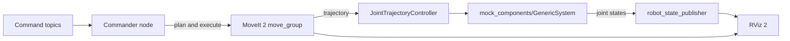

# Architecture

How the pieces of this project fit together and what each one is responsible for.

## Components

| Component | Package | Responsibility |
|-----------|---------|----------------|
| Robot model | `my_robot_description` | URDF/xacro of the arm and gripper, plus a display launch for checking the model in RViz |
| Motion planning config | `my_robot_moveit_config` | Output of the MoveIt Setup Assistant: SRDF (planning groups and named states), kinematics, joint limits and controller mapping |
| Bringup | `my_robot_bringup` | One launch file that starts the robot with its controllers, MoveIt and RViz, plus the controller config |
| Message definition | `my_robot_interfaces` | `PoseCommand.msg`, shared by the commander and anything that sends it commands |
| Commander | `my_robot_commander_cpp` | C++ node that listens for commands and asks MoveIt to plan and execute them |

## Data flow

1. A command arrives on `/pose_command`, `/joint_command` or `/open_gripper`.
2. The commander turns it into a MoveIt goal for the `arm` or `gripper` planning group.
3. MoveIt plans a trajectory and sends it to the `JointTrajectoryController`.
4. The controller drives the mock hardware, which reports joint states back.
5. `robot_state_publisher` turns those joint states into transforms, and RViz shows the result.

## Two launch modes

| | MoveIt demo | Bringup + commander |
|---|---|---|
| Launch | `ros2 launch my_robot_moveit_config demo.launch.py` | `ros2 launch my_robot_bringup my_robot.launch.xml` and `ros2 run my_robot_commander_cpp commander` |
| Who sends goals | You, in the RViz MotionPlanning panel | The commander node, from topic messages |
| Good for | Exploring reachable poses and checking the MoveIt config | Scripted or repeatable motions |

Run only one of these at a time. Starting a second copy of `robot_state_publisher` or `ros2_control_node` makes the arm flicker.

## Design notes

- **Mock hardware.** `mock_components/GenericSystem` echoes commanded positions back as joint states. That lets the whole planning-to-execution pipeline run without a robot or a physics simulator.
- **Mimic joint for the gripper.** Only the left finger is commanded. The right finger copies it, so a single value opens or closes both.
- **`cartesian_path` flag.** With `false`, MoveIt plans a free path between two poses. With `true`, the end effector follows a straight line, which is what you want for moves like descending onto an object.
- **Named states.** `home`, `pose_1`, `pose_2` and the three gripper states are defined in the SRDF, so they can be reused from RViz or code.
